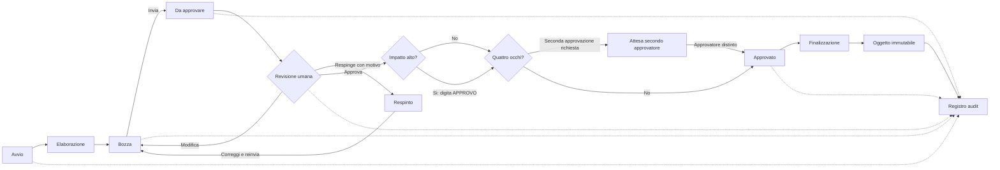

# Flusso delle approvazioni

Il motore di approvazione e il confine obbligatorio tra preparazione ed effetto definitivo.

## Stati

| Stato | Significato | Modificabile |
|---|---|---|
| `BOZZA` | Preparazione non sottoposta a revisione | Si, dall'operatore autorizzato |
| `DA_APPROVARE` | Snapshot bloccato in revisione | Solo tramite respinta o nuova versione |
| `RESPINTO` | Revisore ha indicato una motivazione | Si, creando una nuova bozza/versione |
| `APPROVATO` | Tutte le approvazioni richieste sono valide | No |
| `FINALIZZATO` | Effetto interno applicato e immutabile | No; solo rettifica collegata |

## Precondizioni dell'approvazione

- utente autenticato e membro dell'azienda;
- ruolo `RESPONSABILE` o altro ruolo esplicitamente abilitato;
- approvatore diverso dal richiedente quando e attivo il principio dei quattro occhi;
- sessione con TOTP verificato quando l'azienda lo richiede agli approvatori;
- richiesta nello stato e nella versione attesi;
- motivazione obbligatoria per la respinta;
- `APPROVO` esatto per impatto alto;
- secondo approvatore distinto quando configurato;
- nessuna anomalia bloccante non risolta.

## Diff e trasparenza

La richiesta conserva snapshot strutturati `before` e `after`. L'interfaccia mostra campi aggiunti, rimossi e modificati; per ogni anomalia mostra gravita, spiegazione e origine. I dati visualizzati sono gli stessi coperti dall'approvazione, identificati da versione o digest.

## Concorrenza e idempotenza

Ogni transizione include lo stato/versione attesi. Due approvazioni concorrenti non possono sovrascriversi. Ripetere la stessa finalizzazione non duplica l'effetto: il secondo tentativo viene rifiutato per stato non valido.

## Audit minimo per evento

- azienda e attore;
- azione e oggetto;
- timestamp UTC;
- valori prima e dopo;
- motivazione o commento;
- IP normalizzato quando il proxy e esplicitamente attendibile;
- identificatore di correlazione della richiesta.

> Le valutazioni fiscali e civilistiche rilevanti devono essere validate dal commercialista.

